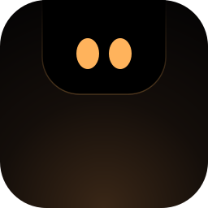
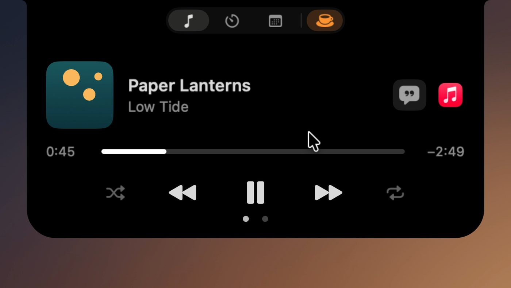

<div align="center">



# Brim

**A quiet Dynamic Island for your Mac.**<br>
Music, lyrics, timers, your next meeting and volume, at the top of the screen.



</div>

## What it does

- Shows what's playing in Apple Music, Spotify or a browser, with controls and synced lyrics.
- Shows volume and brightness at the top instead of the corner.
- Runs a focus timer, shows your next meeting, and keeps your Mac awake when you ask.
- Free and open source. No account, no tracking, no ads.

## Install

Needs a Mac with Apple silicon and macOS 26 or later.

1. Download `Brim.dmg` from [Releases](../../releases/latest). **Only download Brim from there:** a copy from anywhere
   else may have been changed.
2. Open it and drag Brim to Applications.
3. Open Brim. macOS blocks it the first time.
4. Open System Settings → Privacy & Security → scroll down → **Open Anyway**. You do this once.

Brim then shows you around. Every answer is in Brim: Settings → Help & Feedback.

## Privacy

Brim keeps what it knows on your Mac. It goes online only for these:

| Where | Why | What is sent |
|---|---|---|
| lrclib.net | Lyrics | Song title, artist, album, length |
| itunes.apple.com | Up Next for Apple Music | Song title and artist |
| github.com | Checking for updates, once a day | Brim's version number |
| Spotify | Only if you connect it | Your Spotify sign-in, kept in your Keychain |

Each permission (Accessibility, Automation, Calendars, Bluetooth, Notifications) is asked only when you turn on what
needs it.

## Help, ideas and bugs

Post on the [feedback board](https://brim-notch.userjot.com). For a bug, paste Settings → About → Copy Diagnostics: it
holds no song titles or names. Never paste passwords or tokens.

**Security problem?** Don't post it publicly: see [SECURITY.md](SECURITY.md).

## Remove

Right-click the island → Quit Brim, then drag Brim from Applications to the Trash. To remove its settings too, run
[`scripts/uninstall-brim.sh`](scripts/uninstall-brim.sh) (try `--dry-run` first).

## Build it yourself

Swift 6, SwiftUI and AppKit, updates by [Sparkle](https://sparkle-project.org). Needs Xcode 26 on an Apple silicon Mac.

```sh
scripts/check.sh        # builds Brim and runs every test
open build/Brim.app
```

Pull requests with bug fixes are welcome: see [CONTRIBUTING.md](CONTRIBUTING.md).

## Credits

Now Playing by [mediaremote-adapter](https://github.com/ungive/mediaremote-adapter) (BSD-3-Clause), updates by
[Sparkle](https://sparkle-project.org) (MIT), lyrics from [LRCLIB](https://lrclib.net).

MIT License · © 2026 Trikesh · Not affiliated with Apple or Spotify.
